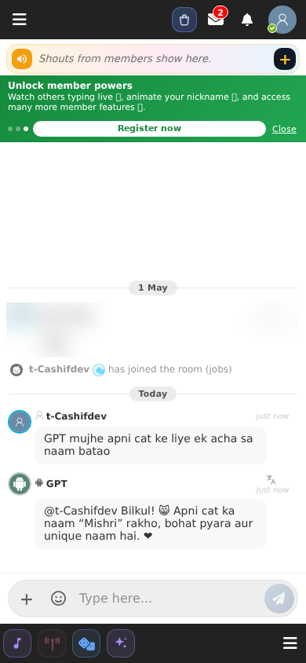
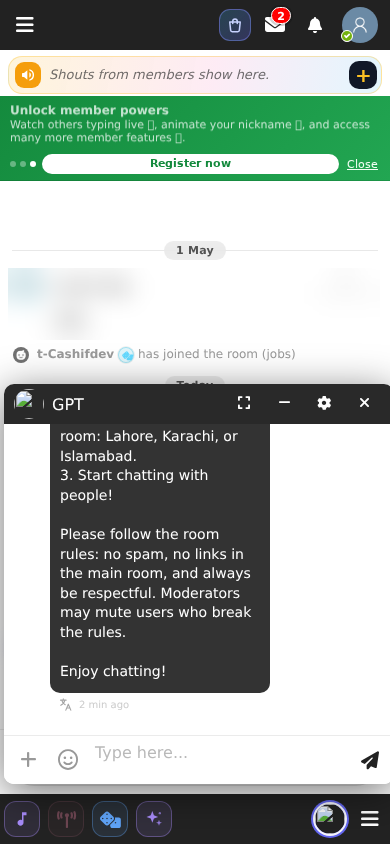
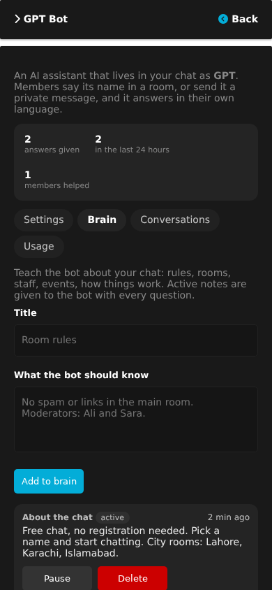
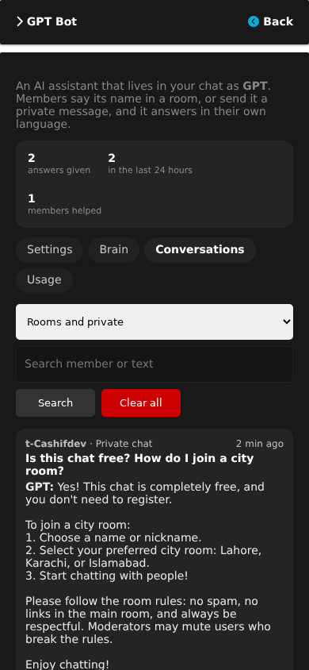

# 🤖 GPT Bot for Codychat 10.1

Give your chat its own AI assistant. Members write **GPT** in any room, or send it a private message, and it answers in their own language within seconds.

**Author:** [M Kashif](https://github.com/cashifdev) · **License:** MIT · **Tested on:** Codychat 10.1

## Screenshots

| Answer in a room | Private chat |
|---|---|
|  |  |

| Brain | Conversations |
|---|---|
|  |  |

## Features
- A real bot member named **GPT** that shows in your user list
- Answers when someone writes its name in a room ("GPT what is the time in London?") and replies with an @mention
- Answers **private messages** too
- Replies in the member's own language: English, Urdu, Roman Urdu, Hindi, Arabic, Turkish and more
- Follows the conversation: it reads the last few messages for context
- **Brain**: teach it about your chat (rules, rooms, staff, events) right from the admin panel
- **Conversations**: see every question and answer, by member, room or private chat, with search
- **Usage**: see how many answers it gave today
- Flood protection per member, extra trigger words, lowest rank that can ask, rooms and private on or off
- Shows as an online member in the user list, with its own GPT avatar
- **100% free. No API key and no setup**: install and it works

## How it works
The add-on sends the member's question, a few recent lines of chat and your Brain notes to the free GPT Bot service at **[chatnoregister.com](https://chatnoregister.com)**, which sends back the answer. Your site gets its own key automatically on the first question.

- **Completely free**, no sign-up and no API key
- A fair-use limit of 500 answers per chat per day keeps it fast for everyone (resets at midnight UTC)

## Requirements
- Codychat **10.1**
- PHP 8.0+ (tested on 8.3) with the **cURL** extension
- MySQL/MariaDB
- Your server must be able to make outgoing HTTPS requests to `chatnoregister.com`

## Installation
1. Download the repo and unzip it.
2. Upload the folder **`gpt_bot`** into your chat's `addons/` folder:
   ```
   your-chat/addons/gpt_bot/
   ```
3. Log in as **owner** → **Admin panel → Add-ons** → **GPT Bot** → **Install**. This creates the bot member **GPT**.
4. Refresh the chat and write `GPT hello` in a room.

The installer creates two tables, `gpt_bot_log` and `gpt_bot_brain`. Uninstalling removes them.

## Settings (Admin panel → Add-ons → GPT Bot)
| Tab | What it does |
|---|---|
| Settings | On or off, answers in rooms, answers in private, lowest rank that can ask, questions per member per minute, your chat's name, extra trigger words |
| Brain | Notes the bot uses with every question. Pause or delete any note |
| Conversations | Every question and answer, newest first, with search and filters |
| Usage | Answers given today and your site key |

## Troubleshooting
| Problem | Fix |
|---|---|
| The bot doesn't answer | Hard-refresh (Ctrl+F5), check the add-on is on and the member's rank is allowed |
| "GPT is busy right now" | Your server can't reach chatnoregister.com, or the service is under load. Check cURL and outgoing HTTPS |
| "answered a lot today" | The daily fair-use limit was reached. It resets at midnight UTC |

## Other versions
Tested on Codychat 10.1 only. Running v11 or an older version? Open an issue titled **Paid install help** and I'll set it up for you.

⭐ If this add-on helps your chat, star the repo and [follow me on GitHub](https://github.com/cashifdev) for more.

See it live at **[chatnoregister.com](https://chatnoregister.com)**.
